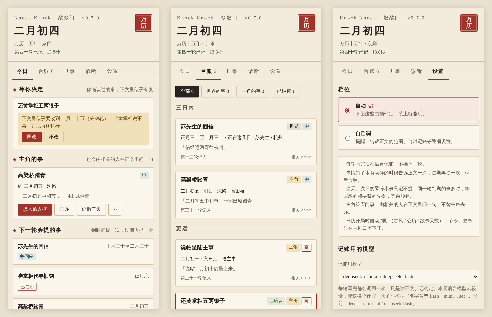
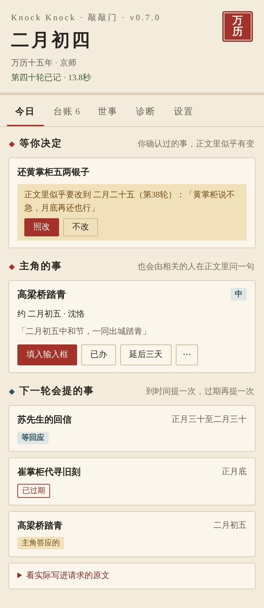
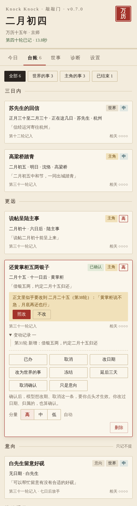
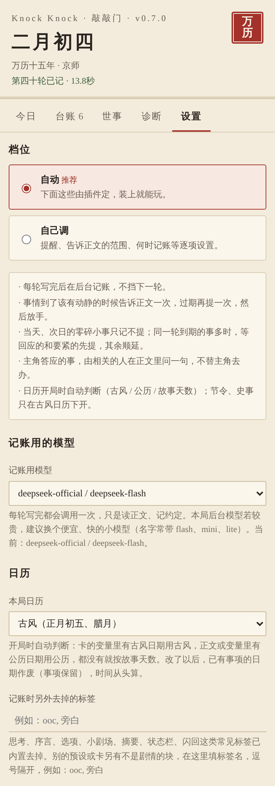
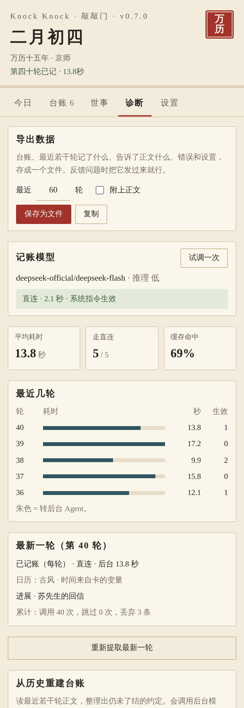
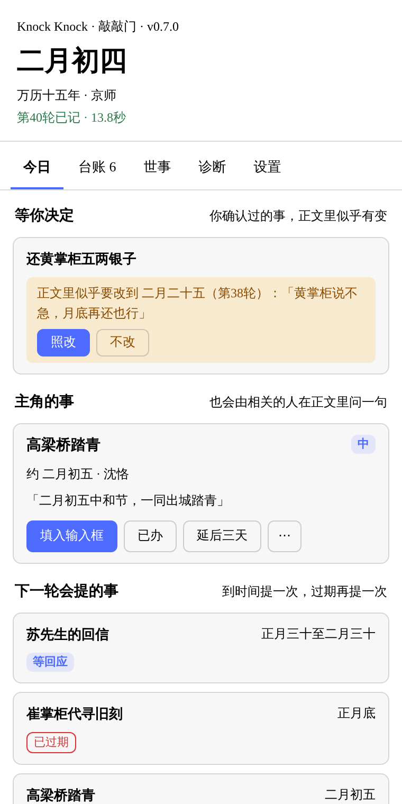

<p align="center">
  <picture>
    <source media="(prefers-color-scheme: dark)" srcset="images/logo-dark.svg">
    
  </picture>
</p>

# Knock Knock · 敲敲门

**DSH Tavern 插件。长局里，让故事推动过的事按时找上门。**

后续提醒 · 控制频率 · 不替你做主 · 后台记账 · 三种日历

[安装](#快速开始) · [看看实际效果](#看看实际效果) · [史事写法](史事条目写法.md) · [反馈](#交流与反馈) · [DSH Tavern](https://github.com/flizzywine/dsh-tavern)

- **不断线**：寄出的信、托人打听的事、约好的日子、答应别人的事，自动记下；到了时间敲一下门，告诉正文一次；过期还没下文，再敲一次。
- **不刷屏**：每件事最多敲两次，每轮最多 3 件；当天的零碎小事只记不提；两次没人应就放手，正文以后再提起会自动重新打开。
- **不替你做主**：只说“按理该有动静了”，到了、迟了、路上丢了由正文决定；主角答应的事只让相关的人问一句，不替主角去办。
- **后台记账**：每轮正文结束后在后台记账，通常可利用阅读和输入的时间完成；下一轮开始时若尚未完成，会先等待。建议选择较快、成本较低的模型，耗时随模型、正文长度和网络情况变化。
- **三种日历**：支持古风日历、公历和故事天数；记账前过滤已识别的选项、小剧场、状态栏等非正文内容。不同卡和预设的适配效果仍需实测。



## 没有插件 vs 敲敲门

|              | 没有插件                    | 敲敲门                                        |
| ------------ | ----------------------- | ------------------------------------------ |
| **寄出去的信**    | ❌ 长局中可能忘记来信，后续未被接上       | ✅ 按路程估好时间，到时候提醒正文：可以送到，也可以交代路上耽搁         |
| **约好的日子**    | ❌ 日期到了可能无人提起       | ✅ 前一天提醒，过了还没动静再提一次                       |
| **答应别人的事**   | ❌ 玩家也可能忘记               | ✅ 「今日」页提醒你；正文里相关的人会问一句，怎么办由你决定            |
| **远方的人**     | ❌ 远方人物的后续可能被忽略           | ✅ 不看在不在场，时间到了，消息照样找上门                    |
| **模型记错了**    | ❌ 缺少独立台账核对                  | ✅ 每条都附正文原话，代码逐字核对；台账可改可删，你确认过的模型改不动      |
| **提醒的分寸**    | ❌ 提醒频率取决于卡和预设     | ✅ 每件事最多两次，每轮最多 3 件，小事只记不提；只是表态的“意向”只记不提  |

## 功能特色

### 到时间敲一下门

记下的每件事都有一个“该有动静”的时间：约好的日子、按路程估的回信时间、上司限的期限。到了这个时间，下一轮的请求里会多一段提醒，正文看到后可以在这一轮或之后几轮安排；过期仍没下文，再提一次；之后算“没下文”放下。正文实际看到的是这样一段：

```
【敲敲门·该有动静的事】（截至二月初四）以下事情按时间该有后续了。可视情形在这一轮或之后几轮安排：到了、迟了、出了岔子都可以；不必硬插进当前场景：
· 苏先生的回信（按路程约在正月三十至二月三十间可到；苏先生；原话「信经运河寄往杭州」）：可视情形安排送到，或交代路上耽搁
· 崔掌柜代寻旧刻（约 正月底，已过 4 日未见下文；崔掌柜；原话「正月底给相公回话」）
· 主角答应的事：高梁桥踏青（期限 二月初五；沈恪）：沈恪可以问一句；主角怎么办由玩家决定，不要替主角去办
结果不预设，消息传到主角需要合理途径；不要替主角做决定，不要为呼应这里而新造原文没有的约定、期限或后果。
```

### 今日：下一轮会敲哪些门

「今日」页列出下一轮会提醒正文的事、主角眼下该办的事。主角的事可以一键填进输入框，也可以标“已办”或“延后三天”。



### 台账：记下的每一件事

全部未了结的事按“已过期 / 三日内 / 更远 / 无日期”分组，每条附正文原话。改日期、改分量、冻结、延后、删除都在这里。

- **意向**：“可以帮你留意好砚”这种表态，记成意向，只记不提，过一阵没动静自然放下；后来说定了会自动转正。
- **确认无误**：点过确认的事，模型想改期、取消，要你点「照改」才生效；你手动改过的也算确认。



### 三种日历，开局自动判断

| 日历 | 什么卡 | 日期写法 |
|---|---|---|
| 古风 | 卡的变量里有古风日期（如“万历十五年二月初五”） | 二月初五、腊月底 |
| 公历 | 变量或正文里有公历日期（如预设摘要里的 `2024-05-31`） | 5 月 31 日（周五）、下周三 |
| 故事天数 | 都没有 | 第 45 天；提醒里写“3 天后”“两三个月后” |

时间按这个顺序取：卡的变量 → 正文里的日期标记 → 正文里的“时间流逝：3 小时” → 模型估计这一轮过了多久。“三年后”这样的大跳跃也能跟上。

### 记账前先清洗正文

思考、序言、选项、小剧场、摘要、状态栏、记忆闪回、MVU 指令都会先去掉再记账，减少把选项里的“约她明天去看电影”误当成约定的情况。别的预设另有这类块，可以在设置里补上标签名。

### 自动档，完成模型设置后使用

档位默认「自动」，提醒的范围、何时记账都由插件定；想细调就切到「自己调」。记账用的模型由你选，用的是本局后台模型时会提醒一次。



### 诊断与导出

每轮记了什么、用了多久、时间来自哪里，都在「诊断」页。出了问题点「导出数据」，把文件发给作者就行。已经玩了很久的局，点「从历史重建台账」，读最近若干轮整理出还没了结的事。



### 史事（古风卡，可选）

给插件一份“历史事件表”：到了日子事件发生，按地点和路程，消息过些天传到主角耳边，之后进世界书条目池。写在卡内世界书里（标题以 `[敲敲门·史事]` 开头、设为禁用），或放进插件的 `packs` 文件夹。[写法 →](史事条目写法.md)

## 看看实际效果

两种皮肤：「古风（宣纸 · 朱砂）」和「跟随 DSH 主题」。



<sub>预览图用插件自己的面板代码和一份虚构的示例数据渲染：万历年间一局，主角林知远。</sub>

## 快速开始

**目标环境**：DSH Tavern 2.6 或更新，需提供插件接口第 2 版。作者此前主要在 2.6 环境使用；本次发布整理未重新验证各宿主版本，更新版本的兼容性以实际运行结果为准。

1. **[下载最新版](https://github.com/dearacknowl/dsh-tavern-knock-knock/releases/latest)**，解压后把整个 `dsh-tavern-knock-knock` 文件夹放进 Tavern 数据目录下的 `plugins` 文件夹。桌面版通常是 `…\profile-data\tavern\data\plugins\`，放好后应有 `…\plugins\dsh-tavern-knock-knock\package.json`。
2. **完全重启 DSH**：托盘图标右键 →「退出」，确认任务管理器里没有残留进程，再重新打开。只关窗口或刷新页面不够。
3. 进一局游戏，右侧栏会出现「敲敲门」面板。到「设置」里给「记账用的模型」选一个便宜、快的小模型，就可以开始玩了。

**卸载**：删除这个文件夹，重启 DSH。

**更新**：用新版文件夹整个替换旧的，重启 DSH。台账保存在每局的插件存档里；更新前请先导出存档备份。本次发布整理未重新验证升级和回退行为。

## 交流与反馈

- **[DSH Tavern 讨论区 · Show and tell](https://github.com/flizzywine/dsh-tavern/discussions/categories/show-and-tell)**：使用经验、建议、问题都欢迎。
- **[本仓库的 Issues](https://github.com/dearacknowl/dsh-tavern-knock-knock/issues)**：反馈故障。

反馈故障时，到「诊断」页「导出数据」，把文件附上。默认不含正文；勾选「附上正文」便于查漏记，但文件里会有你的剧情原文，分享前请检查。

## 已知限制

- 记账可能漏记，也可能把条件建议误记为约定；本次发布未提供统一口径的准确率评测。错的可以在台账里改或删。
- 公历、故事天数两种日历是新加的，实测还少，欢迎用不同的卡试试。
- 史事只读得到**卡内**的世界书；单独挂载的世界书文件，DSH 目前没有给插件读的接口。
- 在 DSH 里给一局“开分支”后，分支里可能每轮都报“找不到本轮正文 operation”。该现象的原因尚未在本次发布中确认；可先回到原局检查，并附诊断信息反馈。

## 隐私

插件只把本轮正文发给你选的记账模型；台账存在这一局的插件存档里，随存档导出、随回退和重新生成自动对齐。除了调用你选的模型，插件不访问别的网络，也不读其他局。

## 许可证

[MIT](LICENSE)

## 本次发布核验范围

本次仅核对发布文件、文档引用及安装包一致性，未重新进行宿主实机验收；预览图为示例数据渲染，不代表新增运行测试。

